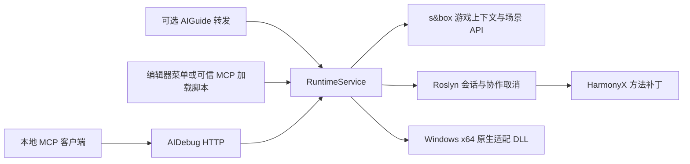

# AI Debug — s&box

这是现有 AIDebug 仓库的 s&box 实现，与 `Godot/` 并列。参考 Godot `84fd57b` 的通用运行时调试边界，使用 s&box 的场景、主线程和可信本地 MCP 接口重新适配。游戏不需要实现存档接口、继承调试基类或录制输入。

## 安装与更新

需要 Windows x64、PowerShell 7、.NET 10 SDK、Visual Studio 2022 C++ 工具，以及与项目匹配的 s&box 引擎。首次安装会构建调试程序集和原生适配 DLL，不重新编译引擎。构建输出不进 Git。

关闭目标项目的编辑器，在本仓库根目录执行：

```powershell
& ./Sbox/Install.ps1 -Project 'C:/path/to/game' -Action Check
& ./Sbox/Install.ps1 -Project 'C:/path/to/game' -DryRun
& ./Sbox/Install.ps1 -Project 'C:/path/to/game' -Engine 'C:/path/to/sbox/game'
& ./Sbox/Install.ps1 -Project 'C:/path/to/game' -Action Verify -Engine 'C:/path/to/sbox/game'
```

安装器只使用 `Sbox/`，支持只检出这个目录。它不拉取代码、不切换 Git 版本；请由调用方先固定仓库提交。`Check` 和 `DryRun` 不修改项目，也不构建。默认安装先构建，再检查部署内容；本地修改或未知文件会拒绝覆盖，验证失败会恢复旧部署、忽略规则和安装记录。旧部署保留在项目 `Art/build/aidebug-installs/`。

Visual Studio 路径不同时，先显式构建，再用 `-NoBuild` 安装已有产物：

```powershell
& ./Sbox/Tools/Build.ps1 -Engine 'C:/path/to/sbox/game' -VsTools '你的VC目录/Auxiliary/Build/vcvars64.bat'
& ./Sbox/Install.ps1 -Project 'C:/path/to/game' -NoBuild
```

项目中 `Editor/AIDebug/` 是部署副本，加入项目忽略规则；源码、通用手册和测试继续由本仓库 Git 管理。安装来源和文件摘要在本机 `.ai_debug/install.json`，不会替换游戏自己的配置。

## 激活

默认不监听端口。编辑器中从顶部 **AI Debug → 启动本地调试** 激活，也可用 `Ctrl+Alt+Shift+F12` 或 `sbox-cli --call aidebug_start`。进入 Play 后可以检查实际游戏场景；`aidebug_stop` 重置并停止服务。仅安装插件不会加载调试程序集；编辑器只保留启动配置检查。

本机 `.ai_debug/config.json` 可配置：

```json
{"enabled": false, "port": 7651, "token": ""}
```

`enabled:true` 或编辑器启动环境变量 `SBOX_AI_DEBUG=1` 可自动启动。手动停止后本次编辑器会话保持停止，重新点击启动恢复。配置和会话文件不共享；`session.json` 记录 PID、项目和地址，不保存令牌。

独立游戏进程也可调试。先使用引擎现有的 `-mcp` 启动游戏，再显式连接其 PID：

```powershell
& 'C:/path/to/sbox/game/sbox.exe' -mcp
# 主菜单就绪后，用引擎 CLI 加载本地项目：
& 'C:/path/to/sbox/game/bin/managed/sbox-cli.exe' --connect 12345 --call instance_console_command '{"command":"game \"C:/path/to/game/game.sbproj\""}'
& ./Sbox/Tools/Start-AIDebug.ps1 -Project 'C:/path/to/game' -Engine 'C:/path/to/sbox/game' -TargetPid 12345
```

当前工作区引擎在冷启动直接传入 `+game` 时曾出现渲染资源锁阻塞，堆栈发生在调试程序集加载之前。上面的主菜单就绪后加载顺序已验证；加载脚本也会检查游戏已结束加载。此问题未修改引擎。

该脚本经引擎现有的可信 `run_csharp` 入口加载本机调试程序集。它不修改引擎、不向游戏 `Code/` 添加引导组件，也不自动注入其他进程。独立进程的 MCP 发现信息可能没有项目路径，因此推荐显式指定 `-TargetPid`。可用 `-Port` 和 `-Token` 指定连接设置。关闭服务可通过可信 C# 调用 `await AIDebug.Sbox.RuntimeService.Stop()`。

## 工具与使用

默认 HTTP MCP 是 `http://127.0.0.1:7651/mcp`。仅绑定 IPv4 回环地址；token 非空时支持 `Authorization: Bearer ...` 或 `X-AIDebug-Token`。提供 JSON-RPC POST、单条请求和 HTTP DELETE 重置，不提供 SSE 或 chunked 请求体。请求头上限 16 KiB、请求体 16 MiB、同时连接 32 个；未完成的请求读取 30 秒后关闭。

| 类别 | s&box 工具 |
|---|---|
| 观察 | `info`、`tree`、`get`、`logs`、`screenshot`、`dump` |
| 操作 | `set`、`call`、`eval_cs` |
| 运行控制 | `pause`、`step`、`time_scale` |
| C# 补丁 | `patch_cs`、`unpatch`、`list_patches` |
| 原生补丁 | `hook_native`、`unhook_native`、`list_native_hooks` |
| 清理 | `reset` |

共 19 项。s&box 不提供 Godot 的 `eval_gd`、`run_gd`，也不会把这两个名字当成 C# 求值的别名。旧 `snapshot_*`、`input_record_*`、`input_play` 等业务存档和输入回放工具已移除。

`tree` 返回游戏对象和组件 GUID。`get/set/call` 可使用 GUID、对象名称或 `root/父对象/子对象#组件类型`。属性支持 `WorldPosition:x`、`GameObject.Name` 这类嵌套路径。重载方法不猜测签名，请改用 `eval_cs` 明确选择。截图渲染游戏场景的相机；dump 写 Windows 进程转储。

C# 全局提供 `Root/Tree/CurrentScene`、`Node()`、`Find/FindAll<T>()`、`Session`、`Cancellation`、`Log()` 和私有成员辅助函数。会话变量跨请求保留：

```csharp
int testValue = 40;
testValue + 2
```

`eval_cs.thread` 可选 `main` 或 `worker`。主线程及其 await 续体进入实际游戏上下文；工作线程适合独立数据，场景辅助函数会拒绝后台访问。跨请求变量中保存的场景对象在工作线程结果中只返回类型占位，避免为了显示变量而读取场景。

每个进程最多一个 C# 求值。`timeout_ms` 为响应和协作取消期限，默认 10000、范围 1–300000；忽略 `Cancellation` 的任务可能继续执行，并继续占用执行槽。超时和断开会请求取消，结果的 `execution_may_continue` 说明是否可能仍在运行。同步主线程死循环仍会卡住引擎，取消不能强制中断它。长循环应检查 `Cancellation.ThrowIfCancellationRequested()`。

`patch_cs` 支持 prefix、postfix、finalizer、transpiler 和 replace。目标示例：`MyGame.Player:Damage(System.Int32)`。补丁使用 HarmonyX；已经内联的调用点可能不经过目标方法，可在启动进程前设置 `DOTNET_JitNoInline=1`。运行中激活不会撤销已经发生的 JIT 内联。

`hook_native` 支持 Windows x64 标准 ABI 的日志采样、整数常量返回和匹配 ABI 的 DLL 替换。浮点参数及返回寄存器会保留，但日志只解释整数参数和返回寄存器。生成日志桩不支持异常展开；原生接口和保留内存的边界见 [Native/NOTICE.md](Native/NOTICE.md)。

`step` 要求先暂停，以 1/60 秒推进指定数量的场景模拟 tick，再保持暂停。它不会驱动完整网络传输、Steam/KCP 循环或真实时钟。`reset` 取消求值、清除会话变量、撤销本模块的补丁，并恢复捕获时的暂停和时间倍率；它不回滚 `set/call/eval_cs` 的任意业务副作用，也不恢复游戏存档。撤销失败会返回错误并保留仍在生效的补丁记录。空闲 30 分钟会尝试同样的清理。

## 与 AI Guide 的关系

两个插件独立安装、独立配置和激活。AIGuide 1.1 在检测到本项目有 AIDebug 时，额外列出 19 个 `ai_debug_*` 工具，调用已经激活的同进程调试模块；不自动加载或启用它。AIGuide 单独安装仍提供原来的 17 项引导工具。演练检查点是编辑器撤销机制，与运行时存档无关；点目录里的本机会话数据不参与演练回退。



## 验证

```powershell
& ./Sbox/Tools/Build.ps1 -Engine 'C:/path/to/sbox/game'
& dotnet build ./Sbox/Tests/SboxDebugFixture.csproj -c Release -o ./Sbox/Art/build/fixture
& ./Sbox/Tools/Test-Install.ps1
# 专用测试项目已启动并进入 Play，或独立游戏已连接并激活调试服务：
& ./Sbox/Tools/Test-AIDebug.ps1 -Project 'C:/path/to/disposable-game'
# 独立游戏没有 AIGuide 转发时：
& ./Sbox/Tools/Test-AIDebug.ps1 -Project 'C:/path/to/disposable-game' -SkipGuide -Token '你的测试令牌'
```

测试会创建运行时对象、修改控制状态、加载测试方法和原生 DLL，并写截图和小型转储。请使用专用测试项目；末尾重置补丁和控制状态，不宣称撤销任意游戏修改。安装器测试只使用自己的临时文件系统项目。
